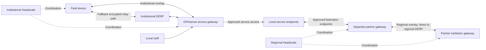

# Connectivity-first resilient datacenter

Status: proposed architecture for user review; no replacement installer is implemented by this document.

## Product goal

An institution starts with a clean, supported Proxmox installation and an administrator's computer. A dedicated, resumable connectivity installer builds its network foundation in logical stages. A separate services installer handles applications; these are separate workflows, not consecutive sections of one installer. At every stage it explains what changed, what was tested, what remains unavailable and the next step. Applications come after connectivity; application deployment, backups and restoration are outside this milestone.

The foundation serves two separate purposes:

1. Field operators and local users reach their own institution's approved services.
2. Approved services communicate with other institutions through a separate network, while each institution retains its own data and authority over access.

The network must minimize dependence on outside services. The target failure scenario is loss of international connectivity while domestic communication paths survive. Local operation must also remain possible without either overlay. No software can preserve communication across a complete loss of every physical path.

A single-node demonstration is a valid installation result, but is not a claim of high availability. Resilience is reported per tested failure and topology.

## Reset and retained work

Build on branch `redesign/connectivity-foundation`, starting from main revision `fbbae78e`. Keep previous branches and evidence intact. Do not delete working modules to make the repository appear new.

The new connectivity journey replaces the product's application-first progression when it is ready. Until then, preserve the old command behavior. Implement the new journey through a clearly named experimental entry point; do not silently reinterpret existing `site.json` or `journey.json` records. A subsequent reviewed release promotes the dedicated connectivity entry point. A generic launcher, if retained, asks the user to choose connectivity or services before starting either workflow.

Reuse code only where it fits this design: bounded TLS-verified Proxmox transport, ownership checks, verified artifacts, private state records, Headscale/DERP deployment, explicit partner approvals, and appropriate tests. Port the confirmed Proxmox feedback fixes from PR #28 when integrating the relevant adapters. The fixed six-VM application layout and mandatory recovery questions must not determine the new plan.

## Chosen architecture

| Role | First implementation | Placement and responsibility |
|---|---|---|
| Edge and institutional access gateway | OPNsense with one Tailscale membership | Local Proxmox VM; WAN routing, segmentation, DHCP and approved field-to-service access |
| Institutional coordinator | Headscale | Dedicated Linux role; deploy locally, deploy on an independently administered supported server, or use an existing endpoint |
| Institutional relays | DERP | Dedicated Linux roles; local or external placement; reachable before joining the VPN |
| Local naming and time | Unbound and a reviewed local time configuration | Local Linux role; stable service records and operation without external DNS/time at startup |
| Partner gateway | Dedicated Linux VM with one Tailscale membership | Local VM; joins the separate inter-institution network and exposes only approved service endpoints |
| Inter-institution coordination and relays | Separate Headscale authority and DERP configuration | Join an existing regional network or explicitly create one; never infer trust from another institution's hostname |
| Connectivity verification target | Restricted temporary test service | Disposable local target for allowed/denied path testing before application installation |

One physical host can run multiple roles for a lab. Separate VMs are not independent power, hardware or upstream failure domains. External infrastructure may be institution-owned or delegated, but the plan must record who operates it and what domestic paths reach it.

The partner gateway remains separate from OPNsense in the first implementation. Do not attempt two concurrent Headscale memberships through the same ordinary Tailscale daemon. This is a deliberate trust boundary, not a claim that other operating-system arrangements are impossible.

The diagram shows logical paths. It does not imply that all field traffic passes through DERP or that Headscale forwards service traffic.

## Addressing, exposure and placement

OPNsense can operate behind NAT; a public address on the portable kit is useful but not mandatory. Successful NAT traversal or a reachable relay is still required. Public IP addresses do not guarantee domestic routing during an international outage.

Prefer stable DNS names and public addresses for externally reachable coordinators and relays. A supported upstream port-forwarding arrangement is also possible. Headscale needs its HTTPS endpoint reachable before enrollment; DERP normally uses TCP 443 and STUN UDP 3478. Public Proxmox administration is not a requirement and must not be enabled by the wizard.

The planner must detect port conflicts. Two VMs cannot both receive the same public address's TCP 443 through ordinary destination NAT. Supported choices are separate reachable addresses, placing one role on another server, or a separately validated shared-ingress/combined-role profile. The first installer must reject an unsupported exposure plan before allocating machines, rather than inventing proxy behavior. Combining Headscale and its embedded DERP can be a future profile, but does not provide independent controller/relay availability.

Each network has an explicit relay map. The domestic deployment profile must operate without downloading or relying on the public Tailscale relay map. Relays for another network are not automatically authorized for reuse; admission policy must match the selected authority. Keep relay admission checks enforced and account for their dependency on Headscale.

For a domestic relay-loss claim, require at least two usable relays in independently assessed locations. An overseas VPS can be additional capacity; it cannot be the only relay or coordinator for the domestic-isolation objective.

Use site-specific private networks. Check overlap with management, uplinks, service segments, partner routes and overlay ranges. The wizard creates or adopts explicitly selected bridges; it does not assume that `vmbr1` is free. Keep Proxmox management reachable without OPNsense, DNS or either overlay.

## Dependency preparation

Before a crisis, prepare:

- Stable hostnames and publicly trusted certificates for network endpoints and later user-facing services. No private CA installation on staff devices and no self-signed production fallback.
- A declared supported-device list and certificate trust tests on those actual operating systems. “Every device” cannot mean all historical trust stores.
- DNS/bootstrap reachability for coordinators and relays before the VPN is connected. A resolver available only inside that VPN cannot be its only bootstrap resolver.
- Local service records independent of external DNS caches. Controller/relay names must still resolve when international paths are blocked.
- Local authentication or prepared device admission that does not require a foreign identity provider during the declared outage scenario.
- Software, configuration, keys and client profiles during normal connectivity. Runtime startup must not fetch missing software or web assets.
- Correct time and a measured certificate/key validity window. Display the actual expiry boundary; public certificates cannot promise indefinite disconnected operation.

Record each dependency's role, operator, location, reachability before VPN, and failure effect. Reachability/location declarations are operator input until tested; the wizard must not infer physical independence from different hostnames.

## Separate installers and opening screen

The proposed user-facing entry points are `./rdc connectivity install` and, in a later services milestone, `./rdc services install`. These are design targets, not commands available in the current checkout. Both can share libraries, but must have separate plans, progress records, execution scopes and completion reports.

Starting the connectivity installer first displays a plain-language scope screen, before collecting credentials, downloading artifacts, contacting deployment targets or changing any machine. Read-only local version/platform detection is allowed. The screen explains:

- **Purpose:** prepare this institution's local network, field-user access and separate inter-institution connectivity.
- **Included:** OPNsense, local DNS/time, selected Headscale/DERP roles, and the partner gateway. Clearly distinguish roles to be created here, deployed elsewhere or connected as existing infrastructure after placement is chosen.
- **Excluded:** Element/Matrix, Nextcloud, SharePoint, SSO application deployment and backups. They are not installed or selected in this workflow. Existing infrastructure authentication dependencies are still disclosed.
- **Prerequisites:** a clean supported Proxmox host, independent administrator/console access, suitable networking, prepared domain/certificate arrangements and any selected external servers.
- **Process:** plan first, review changes, explicitly execute each logical stage, inspect its results, then continue or save and exit.
- **Current effect:** nothing has been deployed by launching the installer; the first action is creating a plan.

Offer `Start planning`, `Resume connectivity installation`, and `Exit`. Before the first remote change, present the actual selected hosts, VMs, networks, public exposure, certificate dependencies and expected connectivity interruption. An opening acknowledgement is not blanket consent to all subsequent changes.

Each stage displays its name and position, its purpose, the target machine and whether it is preparing, changing or checking that target. On resume show completed work, outstanding work and evidence that requires rechecking before offering the next operation. Do not drop the user into an unexplained list of low-level commands.

When connectivity work ends, produce its report and exit. It may explain that services can be installed separately, but must not launch a services wizard, allocate application VMs, download application packages or ask application setup questions. A successful completed run says the connectivity installation is complete for the tested conditions; a partial run says it was saved or blocked, with remaining steps. Neither says the entire datacenter is finished.

The later services installer reads a versioned connectivity handoff containing site identity, approved network attachment points, naming/time endpoints and per-check verification references. It must check current prerequisites and cannot treat a saved report as live health or authority to change network policy. Any additional exposure or partner access needs an explicit connectivity change with review. Services must not overwrite the connectivity installer's state.

## Wizard contract

Every stage has preparation, a change preview, explicit execution, verification and a checkpoint. Show only relevant questions for the selected modules. Users can stop at a checkpoint and resume using the same private record.

Each checkpoint contains:

- **Built/configured:** concrete resources and settings successfully observed.
- **Verified:** named checks, outcome, time and the configuration revision tested.
- **Not yet available:** unmet prerequisites, manual steps and unsupported capabilities.
- **Next step:** one logical action and why it is needed.

A saved plan is never a deployed resource. A running VM is never proof that the expected OS booted. A successful VPN ping is never proof of service access or policy isolation. Manual attestations must be labeled separately from automated observations.

State categories are `planned`, `in-progress`, `configured`, `verified`, `blocked`, and `unsupported`. A configuration change invalidates affected verification. Old evidence is historical, not current health. Skipping a stage cannot mark dependent stages verified. A single overall “resilient” flag is prohibited.

Save state privately and atomically, reject unowned/symlinked records, and prevent concurrent operations in the same workspace. Record intent before remote mutations. On interrupted operations reconcile observed ownership/state; do not blindly repeat uncertain creation, installer start or network changes. Preserve the operator's independent management route. Do not delete VMs, disks or unrelated configurations as automatic cleanup.

## Stages and acceptance gates

### 1. Plan the institution and inspect the host

Collect institution/site identity, independent management access, Proxmox endpoint, storage, NIC roles, network segments and VM capacity. Choose role placement and whether each authority is new or existing. Record domestic versus overseas infrastructure and prepared DNS/certificate paths. No backup or recovery-site questions.

Inspect live permissions, version, interfaces, bridges, storage, existing resources and address conflicts. Show the intended topology and exact remote changes. A clean host may need new bridges, but management-interface changes require a tested safe transition and independent console access; otherwise stop with a concrete manual prerequisite.

Checkpoint: plan accepted and host prerequisites observed, or list exactly what prevents provisioning. No claim of operational connectivity.

### 2. Build the local edge and bootstrap network

Create only the selected connectivity VMs. Use verified, pinned OS artifacts. Install Linux roles using a validated provisioning method. Install OPNsense and record actual OS login/version; use a guided console step until an unattended method is implemented and accepted. A manual step remains visibly pending until completed.

Configure zone interfaces and default-deny policy. Establish the local naming/time role and required maintenance connectivity. A temporary installation path must be explicitly identified and removed or restricted before final acceptance. Configure OPNsense through a supported version-specific adapter; a generated guide alone is not automated deployment.

Test a local client lease, DNS/time access, allowed test-service access, denied management access, and direct Proxmox management with OPNsense stopped.

Checkpoint: local edge operational; external field access not yet available.

### 3. Build or connect coordination and relays

For each selected authority/relay, deploy the dedicated role or validate the existing service. Verify endpoint identity, public certificate chain/hostname/expiry, required ports, private relay map and admission behavior. Discovering a responding HTTPS service is not sufficient proof of the intended authority.

Use separate records and enrollment credentials for institutional and inter-institution networks. Do not keep secrets in the public plan or terminal logs.

Test reachability from outside the local LAN and from the declared domestic path before overlay establishment.

Checkpoint: selected coordination/relay infrastructure usable; redundancy claims limited to actually tested locations and paths.

### 4. Establish field access

Install/configure the OPNsense Tailscale integration and enroll its identity with the institutional Headscale authority. Advertise only approved service routes. Apply Headscale policy and OPNsense firewall rules; test source identity handling, forwarding and return routing rather than assuming the two policies are equivalent.

Prepare a supported field device. Test connection over an independent uplink, local service-name resolution, publicly trusted HTTPS to the test service, denial of management access, direct connectivity where possible, and forced DERP operation. Restart the prepared device and repeat. Record actual devices and paths tested.

Checkpoint: field access verified for the tested conditions; no implied partner-network access.

### 5. Establish inter-institution connectivity

Enroll the dedicated partner gateway in the separate regional authority. Connect only the private service transit segment; prohibit broad staff/management forwarding. Prepare bilateral partner approval and the explicit service endpoint policy. Reuse existing gateway logic only after mapping it to this topology and verifying the mapping.

With a second institution or explicitly labeled disposable peer, test permitted endpoint exchange and denied user/admin endpoints in both directions. No available peer means the stage remains configured but not exchange-verified. Failure of the partner path must not prevent local or institutional field access.

Checkpoint: partner transport and boundary verified for the named peer; actual application federation is a later application acceptance stage.

### 6. Exercise continuity and hand over

Test and report separately:

| Failure | Required observation |
|---|---|
| International connectivity unavailable | Local operation and domestic field/partner access continue through declared domestic dependencies |
| Active relay stopped with direct path denied | A surviving authorized relay carries useful test operations; measure interruption |
| WAN address changes | Prepared identities reconnect over the available path without reinstalling trust |
| Field device restarts | Fresh connection and authenticated test operation succeed under the tested network condition |
| Institutional Headscale unavailable | Record established-session and restarted-device behavior separately; controller-independent continuity may remain unsupported |
| Regional authority or partner gateway unavailable | Local and institutional field access remain functional; affected federation is visibly unavailable |
| OPNsense or host unavailable | Report the local hardware/gateway failure boundary honestly; one host cannot survive its own loss |

Show per-scenario results, measured interruption and remaining limitations. Do not equate simulated fixtures with physical-site acceptance. Do not mark controller-independent access ready when it failed, even if other stages passed.

The connectivity installer ends here with its own report and exits. Application modules belong to the separately initiated services installer; they are not a next stage within this wizard.

## Future static WireGuard option

Keep transport choice separate from network purpose: institutional field access and inter-institution transport are distinct regardless of protocol. The initial implemented transport is Tailscale with Headscale. Reserve the capability boundary for static WireGuard without showing it as an executable option until implemented and tested.

Static WireGuard can supply a prepared path without Headscale discovery. It does not make Headscale itself highly available. It requires independently prepared peer keys, allowed routes, firewall rules and at least one reachable endpoint for a usable path; NAT traversal and endpoint changes remain considerations.

Implement the inter-site fallback first in a later milestone. Field-device fallback is a separate feature requiring supported-device profile distribution and testing; a second tunnel between headquarters does not automatically repair field access.

The future fallback must define separate tunnel address ranges/keys, how routes select a primary path, loop prevention, failure detection, return to the primary path, revocation and operator control. The initial fallback should be explicitly operator-selected until automatic switching is proven. Never switch to a broader access policy during failure. Do not copy a Tailscale identity into a static WireGuard profile.

## Delivery order

1. Dedicated connectivity entry point, opening scope screen, private plan and checkpoint engine, with two distinct network identities, modular placement and dependency reporting. This is preparation only until adapters exist.
2. Clean-Proxmox provisioning and the verified local OPNsense/bootstrap network adapter.
3. Integrated Headscale/DERP placement and enrollment workflows.
4. OPNsense field-access integration and real-device acceptance.
5. Partner-gateway integration and a two-site exchange exercise.
6. Domestic isolation, relay-loss and endpoint-change acceptance with explicit controller/hardware limitations.
7. Separate later work: static WireGuard alternatives, controller continuity and gateway redundancy, followed by application modules. Backups remain outside the current scope.

Each delivery must state whether it produces plans, performs installation, or supplies live acceptance. No scaffold-only delivery is described as a finished datacenter installer.

## Evidence carried forward

The earlier operator report covers nested Proxmox VE 9.2.20 shell allocation, not guest/services/network completion. PR #28 improves planning and permission diagnostics. Existing Headscale, DERP and partner-gateway tests provide reusable component evidence.

The national-isolation draft demonstrates a controller-loss limitation: a restarted field client failed useful access while its authority was stopped. Preserve that result as a requirement-driving failure, not as evidence of achieved controller failover. Existing application/recovery tests do not establish this new wizard's readiness.

## References

- [Tailscale on OPNsense](https://tailscale.com/docs/install/opnsense): client integration and routing/firewall considerations.
- [Headscale DERP configuration](https://headscale.net/stable/ref/derp/): custom relay maps, ports and relay admission dependency.
- [Tailscale control/data planes](https://tailscale.com/docs/concepts/control-data-planes): coordination and traffic roles.
- [WireGuard quick start](https://www.wireguard.com/quickstart/): independently configured peers, endpoints, keys and keepalive behavior.
