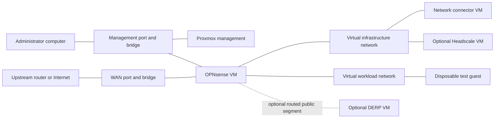

# Two port network appliance version 1 design

Date: 11 October 2026

Status: approved by the project owner on 11 October 2026. The first release includes the two physical port boundary, joining an existing network, and optional Headscale/DERP hosting with separate eligibility checks. Implementation is planned in the [USB and router base plan](../plans/2026-10-11-appliance-v1-base.md), followed by the [network roles and release plan](../plans/2026-10-11-appliance-v1-roles-release.md). This specification does not claim that an installer or accepted appliance already exists.

## Product outcome

An operator writes a prepared installer image to a USB drive, boots a supported computer, and installs Proxmox onto its selected internal storage. A local menu then creates an OPNsense router VM and the appliance's internal virtual networks. The operator can join an existing institutional network and optionally host a Headscale controller or a DERP relay when the selected role's prerequisites pass.

The appliance uses exactly two physical Ethernet ports: management and Internet/upstream. Staff access remains outside version 1. All guest network segments are virtual inside Proxmox. The management port is for administrators, not an ordinary user LAN.

This is a fresh networking product definition. The existing repository supplies research, possible reusable components and historical evidence; its earlier application and recovery milestones do not establish acceptance of this appliance. The earlier roadmaps describe the previous product. Application deployment becomes a later layer consuming documented networking interfaces.

## Scope and supported installation

Version 1 is a fresh installation on one x86-64 computer with hardware virtualization, supported wired Ethernet adapters, local persistent storage and local keyboard/display or an equivalent console. It uses the official Proxmox installer mechanism plus a versioned appliance package. The installed host boots from internal storage; the USB is installation and repair media, not its permanent operating disk.

The initial network profile supports Ethernet upstream access using DHCP or operator-supplied static IPv4 settings. An existing upstream router may provide NAT. PPPoE, upstream VLAN authentication, IPv6-only installations, bonding, multiple WANs and switch configuration are outside this initial profile. IPv6 is explicitly disabled for this profile, including automatic host addresses on WAN and guest bridges, rather than silently bypassing IPv4 policy. A later dual-stack profile needs equivalent routing, firewall and exposure tests.

Each build contains an exact component manifest: Proxmox installation media, OPNsense media, guest base image, appliance scripts and networking binaries, with verified provenance and digests. It declares the hardware and per-role resource budgets exercised by that release. Installation rejects unsupported hardware or insufficient resources before modifying storage. Version selection and measured capacity belong to release qualification, not an unbounded "download latest" operation.

The USB carries Proxmox, the verified OPNsense community installation ISO, the appliance package and everything needed to establish local management and install/configure the router without internet. The OPNsense ISO must actually be installed to the VM disk; reaching its live environment is not completion. The first version may use clearly guided VM-console installation steps. It must not claim a fully unattended OPNsense installation until that path is implemented and accepted. Optional Linux roles can download their pinned dependencies after routing works; fully offline installation of every optional role is not a version 1 requirement.

## Physical ports and virtual topology

| Segment | Physical attachment | Proxmox host address | Other members |
|---|---|---|---|
| Management bridge | Management port | Static management address | Administrator computer and OPNsense management interface |
| WAN bridge | Internet/upstream port | None, including IPv6 link-local | OPNsense WAN interface only |
| Infrastructure bridge | None | None | OPNsense gateway, network connector and selected private infrastructure guests |
| Workload bridge | None | None | OPNsense gateway and a disposable network test guest; future applications later |
| Routed relay segment, when selected | None | None | OPNsense routed interface and separately addressed DERP VM |

The setup menu identifies both physical ports using recorded hardware identities and a link/cable check. Interface enumeration order is not an identity. Changing or replacing an adapter requires remapping through the local console before the previous plan can be reapplied.

Management and private guest subnets are chosen in the site plan, with overlap checks against each other, the upstream and the institutional overlay ranges. They are not globally identical defaults copied into every site. The plan records VM identifiers, VM MAC addresses and network assignments so restarts do not swap OPNsense's interfaces.

Infrastructure guests use plan-assigned static addresses. The disposable workload test guest can use an OPNsense DHCP reservation on its virtual segment. DHCP never serves the physical management or WAN segment. Guest DNS/time listeners use the router's address on the guest's own segment; guests do not need access to the management subnet for those services.

Proxmox owns host networking, bridges, VM placement and host firewall rules. OPNsense owns inter-subnet routing, WAN NAT where applicable, guest gateways and routed firewall policy. The host does not act as a router or NAT gateway between these segments. No ordinary guest joins management or WAN.

Guests sharing a bridge communicate at layer 2 without passing through OPNsense. Version 1 treats each bridge as one trust zone; use different bridges for required routed boundaries. Do not advertise per-guest isolation based only on the router firewall. Hypervisor controls also restrict which guests may attach to each bridge.

## Management and router bootstrap

The management subnet has static Proxmox and OPNsense addresses. The operator receives a printed/on-screen connection card containing the host's numeric address, the required administrator-computer address settings, local login instructions and the management certificate fingerprint. No management DHCP service is required or enabled by default. First connection verifies the fingerprint over the local console; secrets are not printed on the public connection card.

The Proxmox host uses OPNsense's management address as its sole default gateway for permitted outbound traffic. Its own hostname resolves locally. A directly connected administrator reaches Proxmox on the same subnet, without routing, DNS, DHCP, Headscale or external sign-in. When the router stops, host internet access stops but this local management path remains. This does not provide recovery if the physical host itself fails.

OPNsense's management interface is its LAN assignment; infrastructure and workload interfaces are separate optional interfaces. Router administration listens only on management. Bootstrap retains management anti-lockout protection, while replacing broad default forwarding rules with the declared policy before WAN activation. Proxmox host firewall and local authentication protect laptop-to-host traffic, which does not traverse OPNsense. The Proxmox VM console remains available to repair router configuration.

Router installation/configuration starts with its WAN virtual link disconnected. Enable WAN after unique credentials, interface assignment, administration restrictions and the default-deny routed policy are in place. Proxmox never obtains a temporary WAN address to download the router. OPNsense supplies the initial guest DNS service and local time endpoint; separate DNS/time VMs are not required in this version. Local records remain available without upstream DNS, and loss of external time synchronization is reported rather than treated as proof of accurate time.

Management does not become a transit network for workload or partner traffic. DNS, time and outbound update destinations are permitted deliberately. Router administration, hypervisor administration and guest SSH are never automatically exposed on WAN.

## Installation journey and local controls

The host provides one versioned local menu, available at its console and through authenticated management access. The implementation will expose the same operations noninteractively for repeatable tests; command names are an implementation detail.

1. Inspect virtualization support, storage and adapter compatibility. Identify the two ports and show the complete proposed layout.
2. Select the target storage by stable identity, display what will be erased and require explicit confirmation. Do not select the first disk automatically or overwrite an existing host as an implicit upgrade.
3. Install Proxmox and the appliance package from verified local media. Establish local credentials, the management address and host firewall before using the upstream.
4. Create the owned bridges and OPNsense VM from the bundled media. Complete its installation and initial policy through the guided console path. Record completion only after the installed disk boots successfully without its ISO.
5. Enable WAN and check addressing, routing, DNS, time and HTTPS independently. A missing WAN leaves local setup and repair usable.
6. Join an existing network or deliberately create a new controller. Select relay hosting independently. Display missing requirements for each requested role.
7. Install eligible roles into separate VMs using pinned artifacts. Perform the network tests and save their results with the plan and component identities.
8. Export a private recovery package and a redacted connection/diagnostic summary. Remove installation media and verify a full restart.

The menu includes status, resume installation, diagnose uplink, manage selected roles, export configuration and repair router/network configuration. Operations record progress and resource ownership, refuse unrelated VMs or bridges, and can be repeated without wiping state or reenrolling a known node. Interrupted operations resume from checked state. Network changes preserve a known-good configuration and provide console rollback; a lost management confirmation must not silently become the permanent configuration.

No shared password, controller private key, relay identity or enrolled client state is baked into a reusable image. First installation generates unique state. Secrets and enrollment material stay out of source control and diagnostic reports.

## Network participation and optional hosting

The default journey joins an existing institutional network using a dedicated Linux connector VM. Neither Proxmox nor OPNsense must join that overlay for local administration. Joining requires verification of the chosen controller identity and explicit network-owner approval.

Version 1 proves authorised HTTPS communication between the connector and an approved remote test peer, denial against a known listening unapproved endpoint, identity-preserving restart and operation through a configured relay when direct peer traffic is blocked. It does not advertise the management network, a default route, or every internal subnet. Arbitrary subnet routing and application ingress are outside this version; future services must request specific access. Ordinary guest egress through OPNsense is separate from overlay membership.

| Requested capability | Version 1 eligibility and behaviour |
|---|---|
| Site networking | Local management and router are installed. WAN and overlay participation each have their own evidence; a WAN outage does not remove local repair. |
| Headscale controller | Operator intentionally creates a named authority; provides controlled DNS, valid TLS, stable public IPv4 reachability on TCP 443 and independent administration. Explicit upstream forwarding may be used where controlled and tested. A static private WAN address is insufficient. |
| DERP relay | A separate relay VM has a stable publicly routed IPv4 endpoint through OPNsense with the selected DERP profile's required transport, STUN and ICMP reachability. No NAT/load-balancer deployment is accepted for the standalone relay profile. Remote relays remain usable when local hosting is unavailable. |

Static public addressing is the first version's supported infrastructure-hosting policy, not a claim that dynamic addressing is universally impossible. Infrastructure names and TLS must be reachable before overlay enrollment; they cannot depend on the network they are bootstrapping. The initial public-hosting profile does not certify private-only or domestic-only authorities.

Headscale and DERP remain separate roles and VMs. If both are hosted, their public HTTPS endpoints must be distinct. The plan cannot assign the same public IP and TCP 443 to two VMs or to the OPNsense administration interface. The relay profile requires an upstream-routed public address allocation; putting a public address on OPNsense alone does not meet that requirement. One-address HTTPS multiplexing and combined embedded-DERP hosting are deferred rather than silently substituted.

For the routed relay profile, the upstream must route the allocation to OPNsense and the relay must have a working return route. OPNsense excludes that segment from outbound NAT as well as avoiding inbound address translation. Tests verify that the relay's public address is preserved in both directions. This is routed, filtered connectivity, not an unfiltered bridge from WAN to guests.

Controller and relay eligibility checks include actual client operations from an independent endpoint, not only local port probes or a public-IP lookup. Configure endpoints in a provisioning state first; declare them available to ordinary clients only after verification. Without an external test endpoint, hosting remains unverified. Failure of eligibility does not erase an installed authority, switch its identity, or silently claim a successful downgrade.

Headscale controls enrollment, policy and discovery; it is not the normal application traffic router. DERP supplies a fallback encrypted transport path. The relay verifies clients against its selected Headscale authority and explicitly denies new admission if that verifier cannot be reached; do not rely on upstream fail-open defaults. Test unknown identities and verifier outage separately from existing sessions. No promise is made that a newly restarted client remains usable during controller loss in this version.

## Startup, failure and recovery

Host storage, management configuration and local credentials must be available before any VM. Start OPNsense before dependent guests, with bounded readiness checks; start the connector and optional infrastructure roles when their local dependencies are ready. An unreachable WAN cannot block the management menu. Shutdown reverses dependent order, leaving the router until last. Startup ordering alone is not service readiness.

Keep configuration export deliberately small: the site plan, interface identities, VM definitions, component manifest, OPNsense configuration and required network-role state. For a hosted Headscale authority, export its consistent database, policy, configuration and keys together with their component versions; keys alone cannot reconstruct it. Capture uses a supported consistent snapshot or a declared maintenance pause. Connector enrollment state and relay identity/configuration retain their own role labels. Encrypt private exports and test decryption from a separately held credential. Router configuration repair and an isolated reimport are required; complete controller reconstruction, automatic full-host recovery and restoration of future application data are not version 1 acceptance claims. Never activate a copied controller or enrolled node identity while its original is still active.

One host is one failure domain. Co-located controller, relay and router roles share power, storage and host outages. Version 1 neither implements controller failover nor claims high availability, national isolation resilience or uninterrupted relocation. Off-host infrastructure can be selected, but its independence must be established by an actual deployment.

## Status and interface for future services

Report separate states for local management, router readiness, upstream access, DNS/time, network enrollment, controller hosting and relay hosting. Each result includes its check time, plan/component identity and next action. Use explicit configured, verified, blocked, unknown and not-selected states. Saved evidence becomes stale after relevant configuration changes; a historical pass is not a current reachability test.

The public attachment description for a later service layer identifies a schema version, site/network identifiers, virtual network attachment, address allocation method, gateway, DNS/time endpoints and enforced access policy. It contains no secrets. Network enrollment or available egress does not imply application accounts, inbound publication or federation approval.

The networking layer owns connectivity and node identity. Future service modules own application accounts, data and application-specific federation. Application modules must not read private Headscale databases or modify router policy directly; they request a reviewed access change through the network interface. No generic application plugin framework is required for version 1.

## Release acceptance

Every result records the source/build identity, hardware, topology, selected roles and observed outcome. Nested virtualization is useful development evidence; the USB and port claims also require a real two-port machine and an operator other than the implementer.

| Exercise | Required outcome |
|---|---|
| USB install with upstream disconnected | Installs from the selected disk/media plan; Proxmox management and the installed OPNsense VM work without downloading the router. |
| Unconfirmed disk, changed disk identity, bad image or unsupported hardware | Stops before destructive installation; reports the exact failed check. The approved target is checked by identity; the installer cannot infer that an operator deliberately selected an unintended but valid disk. |
| Port mapping and swapped cables | Operator can identify roles; hardware mapping persists; a cable swap never triggers automatic role reassignment. |
| WAN exposure | Independent probe cannot reach Proxmox or OPNsense administration; host WAN/guest bridges have no IPv4 or IPv6 addresses. |
| Virtual routing and separation | Test guest gets declared egress/DNS/time; forbidden cross-zone and management connections fail against known working listeners. |
| Router stopped | A directly connected, statically addressed administrator reaches Proxmox by numeric address and repairs/restarts OPNsense. |
| Boot with no WAN | Local management and router start; dependent remote capabilities report unavailable without blocking repair. |
| Join behind ordinary upstream NAT | Connector enrolls, performs authorised HTTPS, denies unapproved traffic and retains identity across reboot; no inbound forwarding is required for this joining case. |
| Relay path | With the direct data path blocked, a real authenticated HTTPS operation succeeds through the selected relay. |
| Controller hosting | Eligible setup passes fresh remote enrollment and policy tests; absent DNS/TLS/reachability remains blocked or unverified. |
| Standalone relay hosting | Public address is preserved in both directions; real relay/STUN operations pass; unknown identities and unavailable admission verifier deny new sessions. Unsupported NAT/CGNAT topology cannot be labelled eligible. |
| Both hosting roles | Distinct endpoints work independently; no public TCP 443 ownership conflict; management remains private. |
| Loss and return of WAN | Local management remains usable; connector retries without erasing identity or repeating enrollment. |
| Interrupted setup and rerun | Resumes owned state without duplicate guests, lost keys or overwritten unrelated resources. |
| Configuration export and repair | Independent credential decrypts the private export; isolated router configuration recovery succeeds; identity clones remain inactive. |
| Unfamiliar operator | Completes the released USB, wiring, setup, reboot and router-repair journey using only its instructions. |

## Explicit later work

Staff LAN/Wi-Fi, switch VLAN trunks, additional physical ports, Matrix/Nextcloud or other applications, inter-institution application federation, automatic controller promotion, multiple WANs, clustered storage, dual-stack and dynamic-infrastructure hosting, whole-site offline reconstruction and unattended production upgrades are later work. Adding any of them requires its own scope and acceptance criteria; network component count is not an availability measure.

Version 1 delivery proceeds through the base USB/management/router acceptance first, joining an existing network second, and optional hosted-role acceptance third. A base-only build may be published as a preview, but must not be labelled the complete version 1 defined here.

## Upstream references

- [Proxmox installation documentation source](https://github.com/proxmox/pve-docs/blob/master/pve-installation.adoc): official automated installation mechanism. The appliance's safety prompts, media assembly and resume behaviour are requirements of this design.
- [Proxmox network configuration](https://pve.proxmox.com/wiki/Network_Configuration): Linux bridges and host network configuration.
- [OPNsense virtual installation](https://docs.opnsense.org/manual/virtuals.html): supported VM installation through its DVD ISO and guest configuration guidance.
- [OPNsense installation and image verification](https://docs.opnsense.org/manual/install.html): installed versus live environment and upstream integrity checks.
- [Headscale requirements](https://headscale.net/stable/setup/requirements/): public deployment and HTTPS requirements; the static-address hosting policy is a version 1 design restriction.
- [Headscale DERP configuration](https://headscale.net/stable/ref/derp/): relay selection and client verification.
- [Tailscale custom DERP requirements](https://tailscale.com/docs/reference/derp-servers/custom-derp-servers): current direct-connectivity restriction for standalone relays. The routed-OPNsense profile still requires acceptance; documentation is not proof of this appliance topology.
